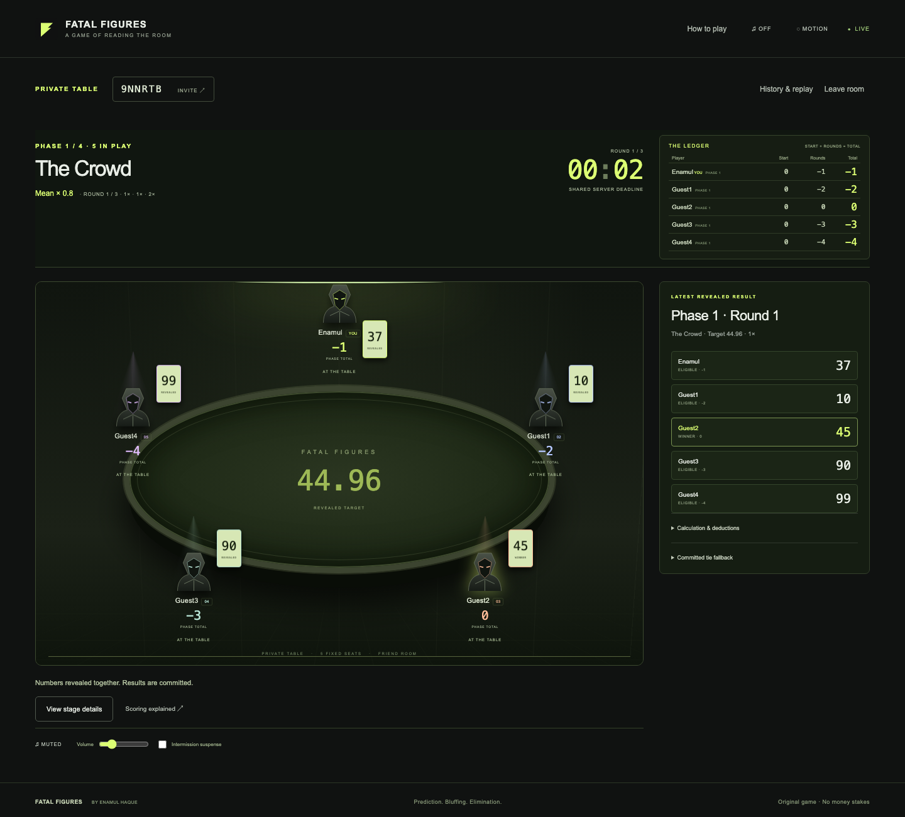
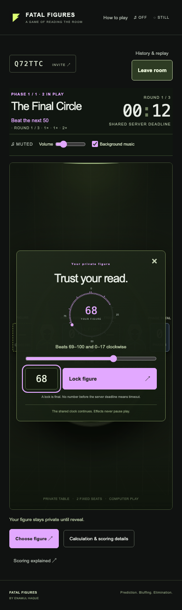

# Fatal Figures

[](https://github.com/Enamul22/FatalFigures-MultiplayerGame/actions/workflows/ci.yml)

**Read the room. Choose your fatal figure.** A real-time strategy game by **Enamul Haque** for **2–5 players**. Secret number choices, changing statistical targets and elimination rounds turn prediction into a contest of nerve.

[**Play Fatal Figures**](https://fatalfigures-enamul22.onrender.com) · [Game rules](docs/PLAYER_RULES.md)

**TypeScript · React · Vite · Express · Socket.IO · Neon PostgreSQL · Render**

- Private friend rooms and practice opponents share the same server-authoritative game rules.
- Durable choice receipts, reconnect recovery and transactional scoring protect match consistency.
- Exact arithmetic, committed tie draws and independently verifiable replays make outcomes inspectable.
- An animated table, phase music and responsive controls support desktop and mobile play.

The free hosting instance may take about a minute to wake after inactivity.



## Play

Create a room, share its code/link, and invite **2–5 people**. Each player picks a
guest nickname, marks ready and the host starts. Practice puts one human against
1–4 clearly labelled strategy bots. Join with a nickname; no account registration is required.

- Choose a whole number from **0–100**, then **Lock figure**. The server commits it
  before confirming; it cannot be changed. Others see only the lock status.
- Three scored rounds per phase: **1×, 1×, 2×** deductions. Closest eligible picks
  share the win; duplicate picks are ineligible in statistical phases.
- Exactly one player leaves each phase. Survivors get a **fresh starting handicap**
  based on the previous phase’s performance, not the previous numerical losses.
- The final two play a 101-position numerical circle. Every figure beats the next
  50 clockwise. The game teaches it interactively before the duel.
- Eliminated players can watch and join a new rematch. History is preserved under
  the old match identity. A host refresh during play retains host identity.

| Players | Phase            | Rule                                                      |
| ------- | ---------------- | --------------------------------------------------------- |
| 5       | The Crowd        | Mean × 0.8                                                |
| 4       | The Balance      | Median × 0.9                                              |
| 3       | The Extremes     | (minimum + maximum) / 2 × 0.7                             |
| 2       | The Final Circle | Your figure beats the next 50 clockwise, wrapping 100 → 0 |

Read [player rules](docs/PLAYER_RULES.md) for scoring examples, duplicates,
forfeits, timeouts, handicaps, ties and the committed random fallback.

## Run locally

Install **Node.js 24 LTS** (with npm). From this repository:

```sh
npm ci
npm run db:local
```

Keep that terminal running. This starts **real PostgreSQL 18** on loopback port
5544 with persistent files in ignored `.pgdata/`, and creates `.env` only if absent.
In another terminal:

```sh
npm run migrate
npm run build
npm run dev
```

Open **http://localhost:3000**. Keep the same browser tab to retain the private
resume capability across refresh. Separate browser profiles/devices get separate
seats. Use the room link/code to invite friends after hosting a reachable server;
`localhost` is local to each device.

Prefer Docker for PostgreSQL? Use `docker compose up -d db`, copy `.env.example`
to `.env`, then migrate/build/dev as above. **Do not start embedded PostgreSQL and
Docker on the same port.** The embedded binaries are a development convenience;
production uses managed PostgreSQL or the compose database. Its installation may
need explicit approval of the platform package’s build script on newer npm;
`db:local` enables the documented automatic symlink rehydration.

To serve the built UI and backend without Vite, set `NODE_ENV=production`, a real
HTTPS `ORIGIN`, database URLs and `HOST=0.0.0.0`, then `npm start` behind a TLS
reverse proxy. `npm start` does not provision hosting. [Manual hosting](docs/HOSTING.md)
contains the provider-neutral container and dedicated Neon setup instructions.

## Verify

Tests require a **separate database whose name ends in `_test`**; they fail instead
of silently skipping real PostgreSQL. Create `fatalfigures_test` and
`fatalfigures_browser_test` using your local Postgres administrator, then:

```sh
# Defaults target only these local test databases on port 5544.
# Override TEST_DATABASE_URL / BROWSER_DATABASE_URL for isolated CI fixtures.
npm run build
npm test
npm run simulate
npx playwright install chromium firefox
npm run test:browser
npm run format:check
```

`npm run db:fixtures` creates those two local test databases automatically. This
helper refuses remote hosts and non-local database configurations. CI uses a fresh PostgreSQL service with isolated fixtures.

The suite covers exact rational scoring, the entire circle matrix, phase/rank
handicaps, bounded ties, deterministic committed draws, production duration,
concurrent real Socket.IO clients, hidden-payload inspection, PostgreSQL
transactions, disconnect/refresh and actual server-process kill/restart. Browser
checks use Chromium and Firefox with five independent sessions, plus phone/touch
interaction, a real timeout, a full elimination ladder, replay, practice and rematch.
Shortened clocks are confined to the isolated browser fixture, never a public
server option. See [verification evidence](docs/VERIFICATION.md) and the committed
[4,000-match simulation output](docs/simulation-results.json).

After downloading a resolved replay or fallback draw from History:

```sh
npm run verify:replay -- fatal-figures-MATCH-ID.json
npm run verify:draw -- draw.json
```

The helpers recompute exact effects and the committed fallback. They do not prove
that a trusted server operator could never cheat or that client network timing was
fair. Unresolved choices are never included in replay downloads.

## Playing room

An atmospheric oval table keeps every original seat in place across eliminations.
Each brighter avatar has labelled FIGURE and PHASE TOTAL cards. A sticky timer
and audio controls remain visible over stage dialogs. Successful locks close
entry automatically; an own read-only receipt can be reopened. Calculation and
scoring details are available on demand, alongside History & replay. Final
champions appear immediately with the decisive revealed choices.

Optional continuous suspense music is locally hosted under CC0; source, terms
and voluntary credit are in [audio licensing](web/public/audio/README.md).
Short original cues, reduced motion, mute and volume remain lightweight and never
delay gameplay. See [room design and verification](docs/ROOM_PRESENTATION.md).

## Engineering

React + Vite, Express + Socket.IO, TypeScript, and PostgreSQL. One Node process
serves both the frontend and real-time endpoint. A direct database advisory lease,
fenced authority row, row locks, versioned checkpoints, append-only public event
records and unique choice receipts provide application-level concurrency and
recovery guarantees.

Production timers cap a five-seat schedule at **28m05s**; a 30-minute watchdog
records Interrupted if the state machine cannot finish. A restart within 10 seconds
and before the current deadline retains the original clock; otherwise Interrupted
preserves committed history without inventing catch-up rounds. Whole-room human
abandonment terminates early. See [architecture and privacy](docs/ARCHITECTURE.md).

Supported topology: **one authoritative Node process per game database**, with
ordinary PostgreSQL clients. A database lease enforces exclusive authority. See [hosting and maintenance](docs/HOSTING.md) for the supported deployment and handover procedure.



## Credits and licence

Inspired by _Alice in Borderland_ and Enamul’s earlier Python number-game experiment. Application code is [MIT licensed](LICENSE). Background music sources and licences are listed in [audio credits](web/public/audio/README.md).

[Architecture](docs/ARCHITECTURE.md) · [Verification](docs/VERIFICATION.md) · [Deployment](docs/DEPLOYMENT_RECORD.md) · [Hosting and maintenance](docs/HOSTING.md)
